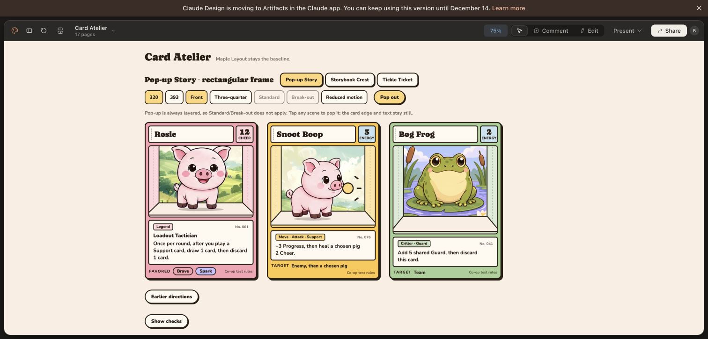
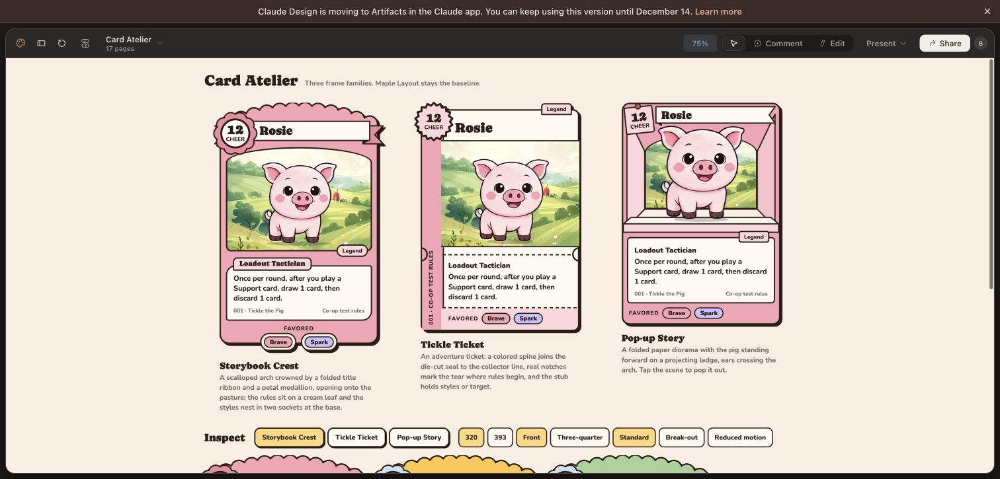
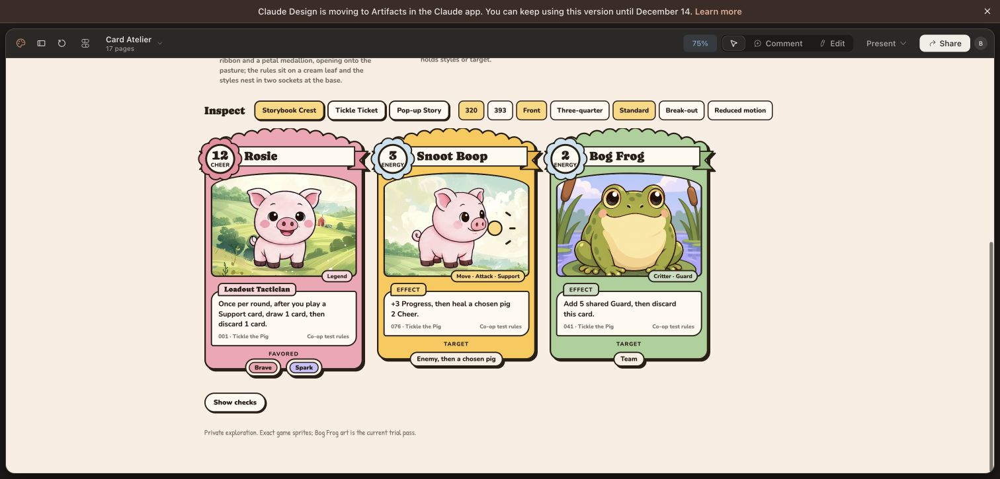
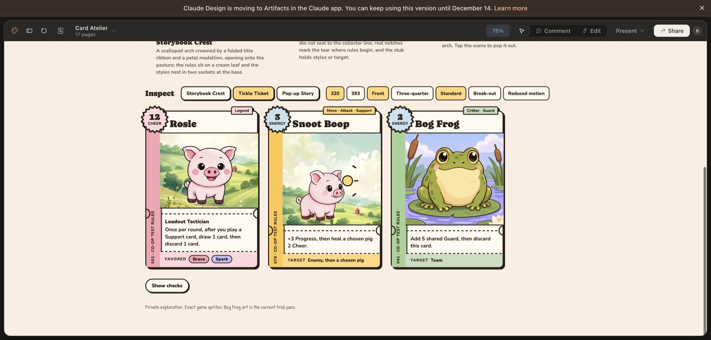
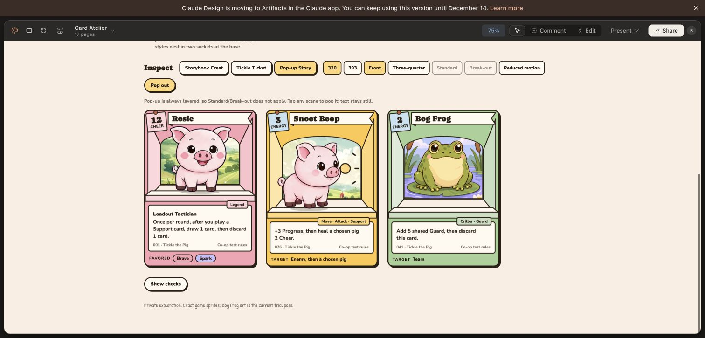

# Card Atelier: expressive format exploration

## Latest direction: rectangular Pop-up Story

The user found the nonrectangular outlines uncomfortable and tentatively favored Pop-up Story. Refine that family around a conventional portrait rectangle with gently rounded corners and a continuous cocoa perimeter. Keep all dimensional effects inside the card: recessed scenery, layered exact game sprite, folded inner walls and ledge. The outer shape and rules text stay fixed during the pop-out spring. This remains an exploration, not a final template selection.

`rectangular-popup-brief.txt` records the focused Claude Design refinement. Prior screenshots below document the earlier three-family comparison.

The live canvas now opens on the rectangular Pop-up family. The outer perimeter is continuous, all three resting cards share dimensions, and the title/stat, folded scene and rules remain inset. Only inner layers participate in the spring. Earlier directions are collapsed below the inspector.

Visually inspected all three at 320 and 393 (the larger layout wraps Bog Frog onto a second row). Exercised Pop out, front/three-quarter, and Reduced motion controls. The frame remains rectangular and the rules stay clear in the captured states; screenshot inspection does not certify animation smoothness. No production source changed.

The user rejected the previous card formats as generic and boring. This exploration changes the frame architecture while preserving Tickle the Pig's established artwork, anatomy, palette, typography and co-op test rules. The existing Maple Layout remains the comparison baseline.

## Design contract

Three reusable families, each supporting Legend, Move and Critter:

- **Storybook Crest:** shaped upper frame, folded name ribbon, integrated medallion, quiet rules leaf and lower Favored/Target sockets.
- **Tickle Ticket:** ticket silhouette, functional side notches, asymmetric spine, offset title and rules/stub construction.
- **Pop-up Story:** layered paper aperture, folded side walls, separate pig sprite and projecting ledge; a deliberate spring interaction with stationary rules text.

Each family must differ in silhouette, title treatment, art/rules seam and stat construction. Color swaps alone do not qualify. Compare the same Rosie content across all three at equal size, then inspect a complete three-card family.

The uploaded Shop reference, homestead scenery, exact game pig sprites and existing WHIMSY tokens remain authoritative. Bog Frog remains trial art. No new mechanics, pig redraws, public sharing, production source changes or release builds are part of this exploration.

`design-brief.txt` records the full brief submitted to the existing Claude Design project. A separate read-only art-direction review identified the same core problem: repeated rectangular compartments, floating stat circles and small decorative details provide weak identity. Its useful constraint is one primary shape, one integrated emblem and one readable rules surface.

## Verification

[Open Card Atelier in Claude Design](https://claude.ai/design/p/aec2145f-9fe2-4416-ab82-50c0100f537d?file=Card+Atelier.dc.html).

The page contains all three Rosie formats together and a family inspector backed by reusable components and shared card data. Visually inspected all three complete families at 320. Exercised family selection, size, pose, break-out, Pop out and Reduced motion controls. Inspected the larger Ticket cards across the scrolled 393 view; the saved 393 screenshot is a partial viewport, not a full-family capture.

One correction batch restored both frog eyes in Crest, reduced its oversized crown and increased the artwork window, enlarged the Ticket stat seal, and removed Ticket's duplicated collector footer. The complete 320 screenshots show the resulting art, stats and rules. Pop-up has a working spring action; these checks do not establish animation frame rate or native-device acceptance.

A separate art-direction review found that the three constructions materially address the generic-format criticism. Pop-up's perceived character scale varies between cards; this is a minor remaining art-direction consideration, not an anatomy redraw. The existing game sprites remain the source.

