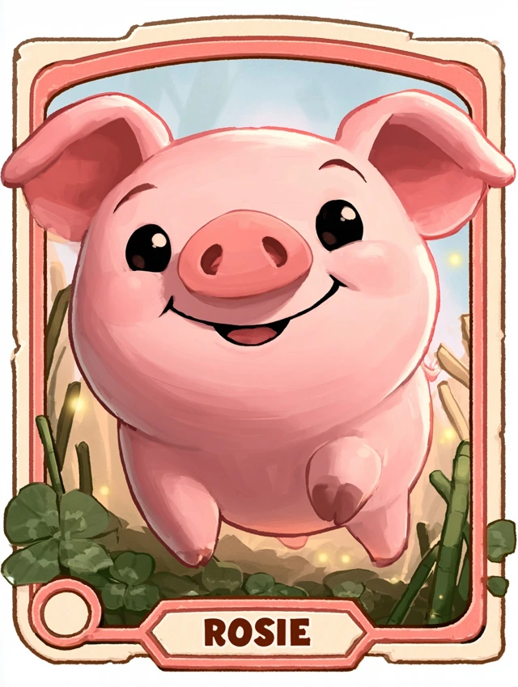
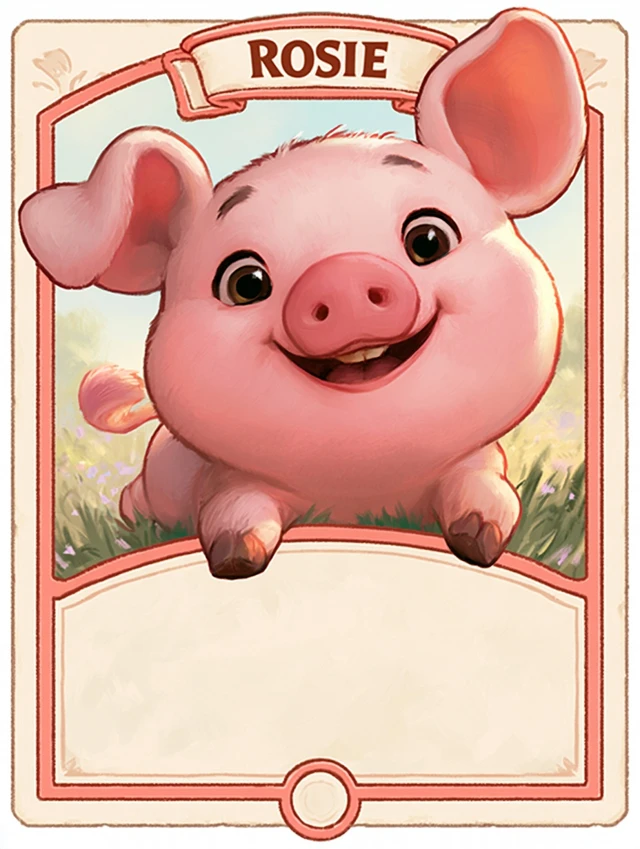
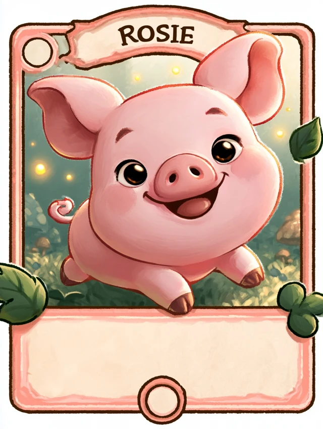

# Card depth exploration

The user asked for Codex CLI and Midjourney examples, then clarified that characters should project out of cards with a bouncy, dimensional feel. This is a concept pass; the current card-opening implementation is unchanged.

## Recommended direction

Start with one **Living Legend Rosie**. Keep the standard framed card and native text, but treat the illustration window as an opening into a small stage. Rosie crouches, springs forward, catches the art rail with her front trotters, and settles while her ears lag behind. The card rocks back slightly under the implied weight. Soft occlusion and a moving contact shadow make the emergence convincing. Names, Cheer, ability, and favored styles remain unobstructed.

Use cheaper layered artwork for ordinary cards. Reserve a full model or shallow miniature scene for the six Legends and selected special treatments. This does not require replacing standard frames with full-art cards.

## Reference principles

| Reference | Observed or documented principle | Translation for Tickle the Pig |
| --- | --- | --- |
| [Marvel Snap art-team interview](https://www.marvel.com/articles/games/inside-the-art-of-marvel-snap) | The team combines frame breaks, 3D effects, and animation for individual characters. | Ears, snout, and selected foliage breach the illustration rim; the information zones stay clear. |
| [Gwent: how cards come to life](https://www.playgwent.com/en/news/6591/gwent-cards-how-they-come-to-life) | Artists derive shallow relief models from finished 2D paintings, then rig and animate them. | Preserve painted texture while giving the foreground real depth and small character motion. |
| [Hearthstone Diamond cards](https://news.blizzard.com/en-us/article/23609768/rewards-track-refresh-diamond-cards) | Blizzard introduced a cosmetic Legendary treatment with bespoke 3D animation and expanded art space. | Give Pig Legends a special sculpted performance while preserving familiar rules and game power. |
| [Pokémon TCG Pocket feature discussion](https://corporate.pokemon.co.jp/en/topics/detail/t-28/) | Immersive cards extend the experience into the illustration. | A special inspect action could later approach a miniature bog scene; ordinary reading remains a framed card. |

These are design references, not claims that all three games use the same renderer or technique. The Marvel interview was available through its indexed primary-source text; direct fetching returned HTTP 403.

The official video [Creating Gwent's Premium Cards](https://www.youtube.com/watch?v=QEONz_QWtjc&t=1034s) includes a chapter labelled “Beyond the Frame” at 17:14. This is a useful production reference; the chapter was located from the official description, not claimed as a frame-by-frame video analysis.

## Three comparison concepts

1. **Layered storybook:** cut-paper Rosie, leaves, and reeds on separate depth planes. Strong parallax and soft shadows, lower runtime cost.
2. **Living Legend:** a rounded matte pig emerges from the art window and rests on its rim. Best first experiment for a true model.
3. **Bog diorama:** a shallow meadow, clover, fireflies, and Rosie inside the card. The most dimensional option, with a larger art and performance budget.

Proposed motion study: 80 ms anticipation, 220 ms spring forward, 300 ms settle, and up to 100 ms secondary ear/tail lag. Tilt stays near six degrees. These are creative starting values, not measured acceptance criteria. Reduced motion holds a static dimensional pose.

## Codex CLI output

The CLI completed an ephemeral, read-only `gpt-5.6-sol` concept pass using the current card screenshot and [brief](./codex-brief.md). Its output is saved in [codex-concepts.md](./codex-concepts.md), with shorter, Legend-specific generation inputs in [midjourney-prompts.md](./midjourney-prompts.md). It generated text prompts, not images or meshes. Unrelated MCP authentication warnings did not prevent the concept response; Claude Design is accessed through the existing browser session.

Midjourney plugin discovery returned no matching connector, so generation used the signed-in website. An initial file-access block and automatic approval rejection were reported to the user; work resumed after the user said the permission had been added. Three jobs completed, producing twelve concept images. All used the same existing Rosie library image as an Image Prompt, `https://s.mj.run/m5uUHMG_n-A`. The attempted upload of the local master was not independently verified as byte-identical to this library reference. Model settings showed 8.2 and output controls identify V8; aspect ratio was 3:4 and stylize was 150. No personalization profile was added.

## Completed Midjourney concepts

These are raster concept images, not meshes or finished animated cards. All twelve 640-pixel-wide WebP previews are saved in [midjourney](./midjourney/), with source URLs in [manifest.json](./midjourney/manifest.json). No HD reruns, paid upgrades, video jobs, or additional variation batches were requested.

| Direction | Completed job | Selected example | Assessment |
| --- | --- | --- | --- |
| A — Layered storybook | [Four results](https://www.midjourney.com/jobs/bd5c92fb-2b59-43b5-813a-aef7acd1c8e2) | [A4](./midjourney/a-storybook-4.webp) | Warm painted character, lifted foreleg, readable name; did not preserve a usable rules panel or strongly separate paper layers. |
| B — Living Legend | [Four results](https://www.midjourney.com/jobs/3205ed98-4d6c-4194-8938-6d993c4332ef) | [B4](./midjourney/b-living-legend-4.webp) | Strong rounded form and hooves catching the art rail; generous rules space, but pose is more a lean than a leap. |
| C — Bog diorama | [Four results](https://www.midjourney.com/jobs/8209f1b4-4e3b-40b1-b377-05494fa1d7a0) | [C3](./midjourney/c-bog-diorama-3.webp) | Recommended starting point for the user's bounce request: diagonal forward pose, asymmetric ears, hoof crossing the art rim, and useful rules space. |

An independent visual review preferred [C4](./midjourney/c-bog-diorama-4.webp) for its richer foliage layers and large rules area. Lead selection is C3 for the clearer spring pose and less eyelash-driven identity drift. C4 remains a useful environment reference. Across the set, ears, eyes, fur, snout and hoof details vary; the eventual model must return to the canonical Rosie model sheet. Generated frame/title geometry is exploratory and should not replace the established card typography.

### Selected examples

Storybook A4:

Living Legend B4:

Recommended bounce composition C3:

The completed job is visible in [recommended-concept-proof.png](./midjourney/recommended-concept-proof.png). The Midjourney tab is left open on C3. These results complement the existing Claude Design motion study; no new UI implementation was made in this generation pass.

## Existing implementation assets

- `assets/models/rosie/rosie-custom-rig-walk-v3.glb`: approximately 5.5 MB, one skin, one walk animation. A pop/lean performance still needs authoring.
- `assets/models/rosie/rosie-meshy-quadruped-v1.glb` and `v2.glb`: static models.
- `assets/models/rosie/img2threejs/`: isolated procedural Three.js pig and browser preview with separate pivots.
- `components/prototypes/card-packs/CollectibleCard.tsx`: an artwork insertion point while the complete card text remains native.

There is no native GL renderer installed. A real-model app version would add a native rendering subsystem and require a development-client rebuild and physical-device testing. A separate browser proof can evaluate the visual direction first.

The model viewport must include the entire protruding silhouette. Background clipping, model depth, frame occlusion, and text overlays need deliberate separate layers; setting `overflow: visible` alone cannot draw outside a native GL surface. Use one active model at a time during opening or inspection, with static album thumbnails and loading/error/reduced-motion fallbacks.

The existing private Claude Design project now includes a separate [Card Depth Studies page](https://claude.ai/design/p/aec2145f-9fe2-4416-ab82-50c0100f537d?file=Card+Depth+Studies.dc.html). Each treatment pairs a resting card with a replayable tilt/pop example. Lead inspection confirmed replay motion and readable name/ability panels; the screenshot is [claude-depth-study.jpg](./claude-depth-study.jpg). These are explicitly 2.5D stand-ins built from masked printed artwork, with approximate edges, a faint duplicate behind the cut-paper example, and drawn placeholder trotters/foliage. Ear lag is present; separate tail lag is not. They establish direction rather than final art quality or real-model acceptance.

No application code, production data, deployment, or distributable build is part of this concept pass. Midjourney generation and local preservation of the twelve previews are complete. A real-model spring animation, frame occlusion, stable live typography, and device performance still need implementation and verification.
