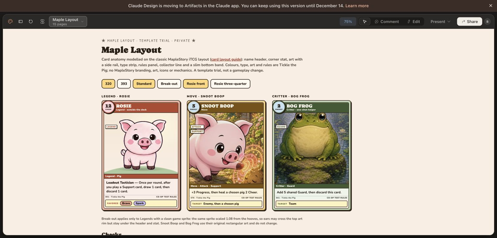
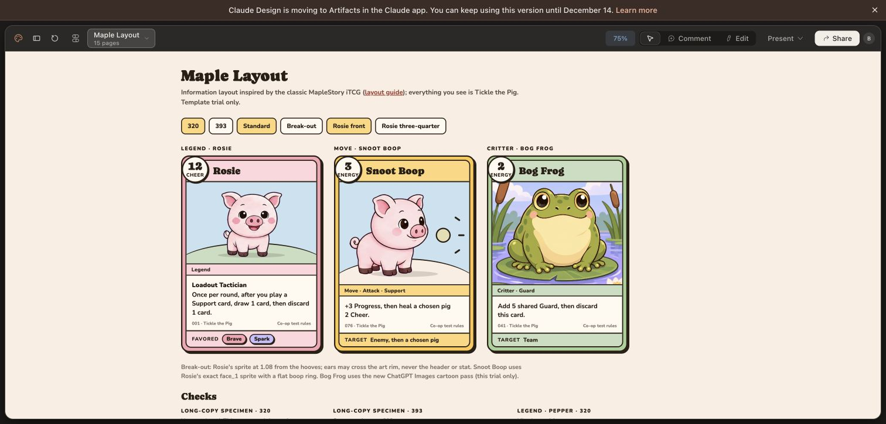
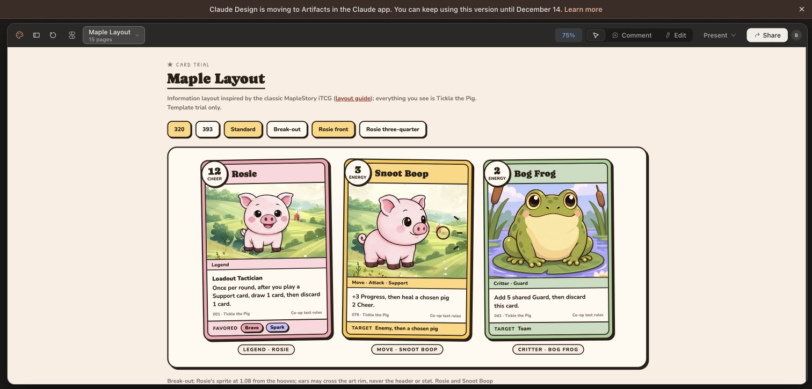
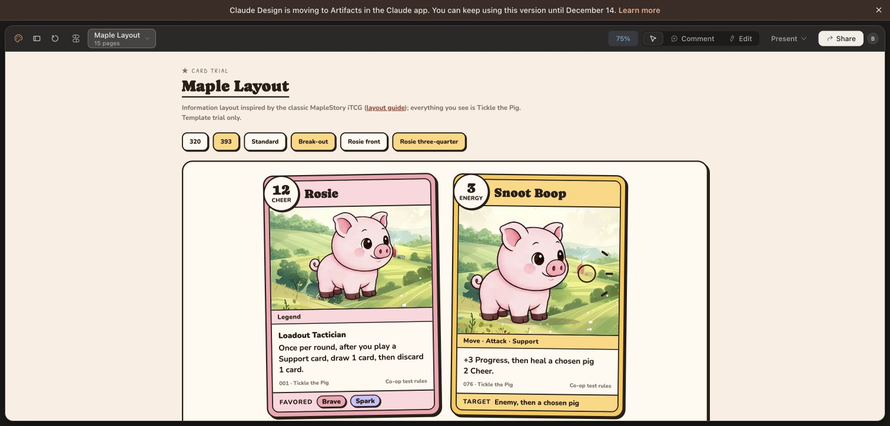

# Maple layout trial

The user selected MapleStory's card layout as the next template to try. This is a new page in the existing Tickle the Pig Claude Design project; the six earlier explorations remain available.

## Reference

[Classic English MapleStory iTCG card anatomy](https://itcg.maplestorygameguide.com/layout.shtml), showing Panda. The original rules also document the separate main card and lower character-action regions: [published rulebook, page 1](https://assets.cardgamegeek.com/public/library/msitcg/MapleStory%20Rules.pdf).

Borrow the visual hierarchy: compact name bar, overlapping corner stat, rectangular art window, type strip, pale rules panel, collector footer, distinct bottom strip. Retain Tickle the Pig colors, typography, characters and rules.

## Field mapping

| Region | Legend | Move | Critter |
|---|---|---|---|
| Name | Rosie | Snoot Boop | Bog Frog |
| Corner stat | 12 Cheer | 3 Energy | 2 Energy |
| Type strip | Legend | Move · Attack · Support | Critter · Guard |
| Rules | Loadout Tactician: once per round after a Support, draw 1 then discard 1 | +3 Progress; heal a chosen pig 2 Cheer | Add 5 shared Guard, then discard |
| Bottom band | Favored: Brave, Spark | Target: Enemy, then a chosen pig | Target: Team |

No imported MapleStory level-up, class-color or combat mechanics. No invented persistent Critter health. Fine print identifies co-op test rules.

Rosie uses the exact `assets/images/sprites/rosie/idle_1.png` and `face_1.png` pixels with uniform scaling. Full head, compact torso, short legs and hooves stay visible. Break-out is a restrained layer effect; typography remains live and protected.

`design-brief.txt` preserves the submitted specification. `maplestory-layout-reference.png` records the source page that informed the trial.

## Result and verification

[Open Maple Layout in Claude Design](https://claude.ai/design/p/aec2145f-9fe2-4416-ab82-50c0100f537d?file=Maple+Layout.dc.html).

Verified Rosie, Snoot Boop and Bog Frog render the mapped fields at 320 and 393. Rosie front/three-quarter and Standard/Break-out controls change the intended view while retaining the original short-legged anatomy. Inspected long-title and long-rule samples at both widths: text wraps without crossing the rules/footer/bottom-band boundaries. Pepper provides another original-sprite Legend example. Screenshots record the standard trio, larger break-out state and typesetting checks.

This remains a private design prototype. No production React Native source or gameplay logic changed, and production release checks were not run for this canvas-only trial.

## Clean, crisp, cartoony refinement

The follow-up keeps MapleStory's information hierarchy while removing the muddy frame colors, bevel stack, paper texture, redundant tiny type labels and mismatched painterly scenes. Use clear cocoa outlines, light rose/sun/sage surfaces, larger title-case names, readable rules and consistent spacing.

Rosie and Snoot Boop share the exact live-game sprite; Snoot Boop adds a simple ring/spark effect rather than a new pig drawing. `bog-frog-crisp-cartoon.png` is a new ChatGPT Images restyle of the existing frog illustration, with Rosie's sprite supplied only as a style reference. It is a design-trial asset, not a replacement of the production original. The submitted frame/type direction is saved in `crisp-refinement-brief.txt`.

Verified the refined trio at 320, the 393 break-out/three-quarter state, and the long-copy specimens at both sizes. The same card-data fields remain visible; the new frog shows its eyes and feet. This is browser-canvas verification, not native-device acceptance. No production source changes.

Tooling context reported an obsolete PRODUCT.md Register section, a stale Impeccable design sidecar and an available skill update. These unrelated files were left untouched; a separate context/document refresh can address them.

## Established app style takes precedence

User clarified that clean, crisp and cartoony must still mean the existing Tickle the Pig style. MapleStory supplies the information layout only. The authority is `constants/theme.ts`, `components/ui/Sticker.tsx`, `docs/design/taste-standard.md`, live pig sprites and existing registered backgrounds.

Keep warm cream paper, muted WHIMSY colors, cocoa outlines, the two hard sticker-shadow tiers, subtle handmade tilt, Caprasimo/Nunito typography, gently shaded characters and illustrated scenery. Preserve crisp text panels without flattening the whole world into a new cartoon style. Restore the actual homestead pasture behind the pig cards instead of the generic geometric hill.

References: `docs/design/shop-ia-2026-09-17/img/01-first-screen.png` (saved Shop capture), `assets/images/backgrounds/homestead_barn.jpg` (registered default background in `PageBackground`), and `assets/images/backgrounds/reed_marsh_bg.png` (registered scenery reference). The Shop capture is a saved visual reference, not a newly captured current runtime screen. User explicitly approved sending these three references to Claude Design after automatic approval review blocked the initial submission. No other external asset-sharing permission is inferred.

The new frog remains a trial illustration, not an authoritative source for restyling the rest of the game. Existing game sprites and scenery outrank generated art.

The Maple Layout canvas now uses the actual homestead barn scenery behind Rosie and Snoot Boop. The surrounding page uses a cream paper panel, cocoa borders, hard sticker shadows, gentle card tilt and the established typography. A collapsed app-reference panel records all three references; the marsh is a reference only. Card fields and game sprite artwork remain intact.

Visually checked the full trio at 320/Standard/front, plus Rosie and Snoot Boop at 393/Break-out/three-quarter. Titles, corner stats and rules remain separated, and the pig proportions are preserved. These are canvas checks, not native-device or animation acceptance. No production source changed.

