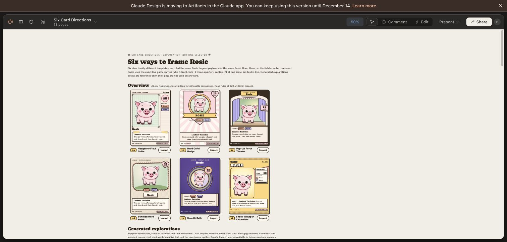

# Six card directions — 2026-10-13

Exploratory layouts, not a production selection. Existing game rules and assets are unchanged.

[Editable Claude Design comparison](https://claude.ai/design/p/aec2145f-9fe2-4416-ab82-50c0100f537d?file=Six+Card+Directions.dc.html)

| # | Direction | Generated concept source | Main idea |
|---|---|---|---|
| 1 | Hedgerow Field Guide | ChatGPT Images | Asymmetric specimen plate, notes margin, taped rules page |
| 2 | Herd Guild Badge | ChatGPT Images | Rosette, character medallion, title and rules ribbons |
| 3 | Pop-Up Porch Theatre | Midjourney | Layered paper stage, hanging stat, foreground projection |
| 4 | Stitched Herd Patch | Google Flow / Nano Banana 2.1 | Scalloped embroidery, applique, rules name tape |
| 5 | Moonlit Relic | Midjourney | Crescent aperture, orbit jewel, parchment scroll |
| 6 | Snack-Wrapper Collectible | Google Flow / Nano Banana 2.1 | Crimped edges, diagonal title, nutrition-style facts |

## Character and data contract

Editable cards use the exact game sprites `assets/images/sprites/rosie/idle_1.png` and `face_1.png`, maintaining their 370 × 383 aspect ratio. Large head, compact torso, short legs and small hooves are authoritative. Generated artwork is material/layout inspiration, not a replacement character source.

All Legends use Rosie, 12 Cheer, Loadout Tactician, Brave and Spark, and: “Once per round, after you play a Support card, draw 1 card, then discard 1 card.” The comparison also supplies Snoot Boop Move variants. Printed rules are co-op test rules.

## Saved outputs and limitations

- `generated/01-field-guide-chatgpt.png` and `generated/02-guild-badge-chatgpt.png`: original ChatGPT image outputs, using the game Rosie reference. Decorative generated copy is not canonical.
- `midjourney-frames-proof.png`: browser proof of two completed frame batches, four variations each. Moonlit Relic is the upper row; Porch Theatre is the lower row. Empty art apertures intentionally reserve space for the real game character.
- `google-frames-proof.png`: browser proof of two completed frame concepts. Original download and asset export failed; the live Google project retains the originals.
- Google ImageFX redirected to Flow, whose visible choices were Nano Banana models. These results are **Nano Banana 2.1, not Imagen**.
- Automatic approval review rejected a new original Rosie upload to Midjourney as proprietary-asset egress requiring explicit permission. No such new upload was completed; frame-only generation allowed work to continue. A retained older Midjourney reference contaminated the first two batches; those wrong-body results were rejected. Corrected batches have no image prompt attached.
- No production frontend, gameplay, deployment or account upgrade was performed in this exploration.

## Live generation records

- [Midjourney theatre batch](https://www.midjourney.com/jobs/e64be86f-928c-418c-b30c-2d4aef1ad8e8?index=0)
- [Midjourney moonlit batch](https://www.midjourney.com/jobs/5f5187cf-b1b2-4edd-89b7-921e41b51049?index=0)
- [Google Flow project](https://flow.google.com/project/ffe20614-78b5-446b-bf80-5bcff2441d9a)

## Initial design judgment

Guild Badge is the strongest Legend silhouette. Porch Theatre best supports a restrained character projecting forward over the art rim. Field Guide offers the calmest rules hierarchy. Patch is the warmest; Wrapper is the loudest; Relic may suit rare cards more than an everyday template.

## Verification

Verified the Claude page displays all six original-sprite Legend candidates, paired Move previews, and correctly labelled generated reference images. Inspected the Guild Badge at 393 and Theatre at 320, including break-out and alternate-pose controls. The theatre screenshot confirms the full short-legged body and unobscured rules panel. This is visual exploration, not a comprehensive production accessibility or gameplay test.

