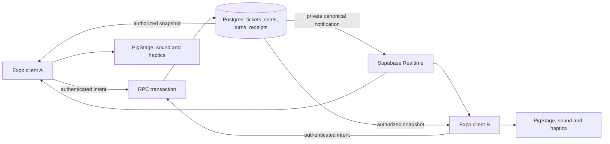

# Matchmaking and the first live mode

**Superseded for first-mode/product scope on 2026-10-02:** the user requires head-to-head wins/rating and competitive plus cooperative options. Read [ranked-matchmaking-spec.md](ranked-matchmaking-spec.md) for the current proposal. This document retains the original cooperative Duet exploration and useful transport/concurrency detail; its private codes, rematches, no-rating first slice and disconnect policy are not the revised ranked scope.

Date: 2026-10-01. Status: **proposed implementation specification**. No migration, production change, build, or issue publication is part of this exploration.

Build **Tickle Duet** as a two-player, unranked, ~72-second co-op game available to all authenticated players. Reuse Expo, Supabase Auth/Postgres/Realtime, the RPC layer, PigStage and existing paper UI. Keep practice local and explicitly labeled. Put membership, accepted phrases, deadlines, results and any later keepsake on the server.

This design assumes discrete turns with generous response windows. It is not a technical plan for continuous physics, twitch competition, or a large shared world. One small alternating-exchange implementation is enough; avoid a general minigame engine before the second mode exists.

## 1. Existing code and what it proves

| Evidence | Useful foundation | Required change for live matches |
| --- | --- | --- |
| package.json | Expo 57, React Native 0.86.2, Supabase JS, Skia, current native/web Rive packages are installed | No framework upgrade is prerequisite |
| hooks/useLoungePeers.ts:1–7, 78–85 | Presence, Broadcast, payload checks and channel lifecycle | Lounge state is explicitly client-authoritative and channel setup is currently public; do not reuse that trust model |
| supabase/migrations/20260766000000_lounge_channel_auth.sql | Existing Realtime authorization policies | They are VIP/Lounge policies, not match membership policies; new exact-topic and message-extension policies are needed |
| components/BarnVisitModal.tsx and components/ui/PigStage.tsx | Two equipped pigs on one ground line, facing and reactions | A dedicated gameplay screen and accessible gesture controls |
| components/ui/rivePigAsset.ts:6 | Raster fallback is available | Custom RIVE_PIG_SOURCE is undefined; Rive polish must not block the first prototype |
| utils/rpc.ts | rpcAction/rpcOutcome, normalized failure paths and logging | Typed multiplayer contracts and defensive parsing |
| hooks/usePostgresChanges.ts | Exact-channel, idempotent cleanup | A dedicated private Broadcast/Presence hook, with the same cleanup discipline |
| supabase/migrations/20260917170000_ghost_sheep_trader.sql and 20260917100000_satchel_swaps.sql | Nonce receipts, transaction locks and ledger-first mutations | Apply these patterns to sessions and phrase receipts |
| utils/interactionAnalytics.ts | Closed analytics event/property vocabulary | Add explicit multiplayer tokens, not arbitrary payload telemetry |
| CONTEXT.md | Sounder is an asynchronous crew; Truffle Patch is personal | Temporary matches have their own domain and routes |

The August Rive multiplayer research is useful for the presentation/network boundary but its Expo/runtime baseline is historical. Current code is the baseline here. The repo-specific GitHub request could not be retrieved during this audit because the CLI could not reach api.github.com; no issue number or issue-specific acceptance criteria are assumed.

## 2. Architecture

React Native renders pig reactions immediately. Meaningful completed inputs go through authenticated RPCs to Postgres. Postgres checks and commits the action, then publishes a private canonical notification. Both devices recover state from a snapshot after missing notifications.

RPC transactions are the authority. Realtime improves responsiveness; a lost message must never change the result. Presence is a connection hint, not readiness or proof of participation.

Supabase supports database-origin Broadcast and membership-scoped private-channel policies. Use those capabilities rather than trusting a client claiming to be the host. [Database Broadcast](https://supabase.com/docs/guides/realtime/broadcast), [Realtime authorization](https://supabase.com/docs/guides/realtime/authorization).

No new dedicated server is needed for this proposed cadence. Hosted Edge Functions have bounded lifetimes; they should not be treated as persistent game-room processes. A future reflex/physics mode would require a separate transport/authority spike. [Edge Function limits](https://supabase.com/docs/guides/functions/limits).

## 3. State and storage

Ticket: **waiting → assigned**, or **cancelled / expired**. Match: **ready_check → countdown → active → completed / incomplete / aborted**. A rejected action does not advance state. A ready failure aborts before play and can requeue the ready partner with original priority.

Provisional tables:

| Table | Essential fields and invariants |
| --- | --- |
| multiplayer_tickets | id, user_id, source (public/private/rematch), mode, protocol_version, rules_version, join_nonce, joined_at, last_seen_at, expires_at, status, match_id. Partial unique index on user_id for waiting/assigned tickets. A nonce replay resolves the original request rather than creating another ticket. |
| multiplayer_matches | id, mode, protocol_version, rules_version, state, revision, ready_deadline, starts_at, ends_at, current_exchange, canonical_state, result, terminal_reason. Rules are immutable for a match. Seeds, if needed, stay server-private. |
| multiplayer_match_players | match_id, user_id, seat, ready_at, last_seen_at, appearance_snapshot, released_at. PK (match_id,user_id); unique (match_id,seat); partial unique user_id where released_at IS NULL prevents two live matches. |
| multiplayer_actions | match_id, user_id, action_nonce, exchange_no, role, bounded phrase, server_received_at, accepted receipt. Unique (match_id,user_id,action_nonce); unique accepted (match_id,exchange_no,role). Replay with a different payload is rejected as nonce_conflict. |
| multiplayer_private_rooms | id, creator_id, code_hash, mode/versions, invited_user_id if targeted, expires_at, consumed_at, match_id. Never expose a public room list. One creator room reservation occupies the same active-ticket slot. |
| multiplayer_active_reservations | user_id PRIMARY KEY, kind (queue/private_room/match), exactly one corresponding reference, expires_at. One shared row prevents a user holding different live activities across tables. Every allocation/release path updates it transactionally. |
| multiplayer_request_receipts | UNIQUE(user_id,operation,request_nonce), request_digest, original_decision/reference. Replay retains the same resource identity and returns its fresh canonical projection; immutable action receipts retain the original outcome. |
| multiplayer_code_attempts | user_id, window_start, count. A per-user atomic limiter allows at most 10 code-join attempts per 10 minutes before accessing the global coordinator. Wrong/expired/consumed/unauthorized codes share invalid_code. |
| multiplayer_keepsakes | Optional after the first slice: (user_id,keepsake_key) unique for a first-Duet stamp, with qualifying match reference. A retry cannot grant it twice. |

Do not put both players' hidden role data into public canonical_state if a later mode needs secrecy. Build role-specific server projections before Truffle Trail or Picnic Relay. Keep raw actions/seed private; expose a small authorized snapshot RPC.

Enable RLS and explicitly set grants on every exposed table. Clients have no direct gameplay INSERT/UPDATE/DELETE. SECURITY DEFINER RPCs use a fixed safe search_path, qualify objects, derive the caller from auth.uid(), and revoke helper execution from PUBLIC/anon. [RLS guide](https://supabase.com/docs/guides/database/postgres/row-level-security), [Database function security](https://supabase.com/docs/guides/database/functions).

## 4. Atomic pairing and low population

Start with one global, short transaction-level **matchmaking advisory lock** for public join, private-room join, cancellation, requeue and rematch allocation. This intentionally serializes low-volume coordination and is easier to prove than a partially locked candidate scan. Do not hold it during network calls, play, or animation. Match actions only lock their match row.

The lock order is matchmaking lock before match row whenever a coordinator needs both. Action RPCs never acquire the matchmaking lock after taking a match lock. Transaction constraints remain the final defense.

Complete order: coordinator → match → match-player rows in seat order → reservation/ticket/room rows → action/request receipts. Heartbeat/actions/active settlement take match → players → associated rows and never later acquire the coordinator. A snapshot that might reconcile ready timeout/requeue acquires the coordinator before the match; active-only turn reconciliation needs the match lock only. This classification must be explicit in helpers.

Every terminal transition releases both active reservations, sets both seats' released_at and terminalizes associated tickets in the same match-locked transaction. Ready-timeout requeue is a coordinator operation: release the old pair, create the ready player's replacement reservation with its original joined_at, and leave the unready player's ticket terminal. Rematch cannot allocate before release.

Within join:

1. Authenticate; check server enable flag and supported protocol/rules. The client does not choose arbitrary rules.
2. Under the governing lock, reread the request receipt, compare its digest, and replay the same ticket/match reference with a fresh canonical projection. Return an existing live reservation for a new join request rather than allocating another. Reject conflicting nonce reuse.
3. Reconcile expired reservations; exclude users with an unreleased live seat.
4. Select the oldest waiting ticket with the same mode/protocol/rules, a fresh heartbeat, no self-pair and no blocks in either direction.
5. Recheck both players under the transaction. Create exactly two seats and a ready-check match, mark both tickets assigned, and return a canonical envelope.
6. Otherwise create one waiting ticket. No broad rank, region, cosmetic, membership, or Sounder filters at launch.

Use proposed initial settings: heartbeat every 5 seconds while foregrounded, stale ticket after 15 seconds without heartbeat, 45-second overall queue expiration, a 15-second ready check, a 3-second countdown, and a practice offer after 12 seconds. These are tuning hypotheses, not current measurements. Queue status polls about every 2 seconds; heartbeat is a separate bounded update, not a write on every poll.

**Practice transition:** accepting Practice Pig requests cancel-to-practice under the same coordination lock. If the ticket is still waiting, cancel and start a local practice game only after the confirmed response. If a human assignment already exists, return that match and show Ready; never leave a matched human with an invisible missing partner. On an unknown cancellation outcome, recover before starting practice. Practice produces no multiplayer actions or keepsake; it emits practice_chosen and is excluded from match_found, human-fill and multiplayer-completion metrics.

Do not display guessed waiting counts. Keep one public queue. Scheduled play windows can be tested if actual human fill is poor; no reminders or automations are created by this spec.

### Play with a friend

Use **Create code / Enter code**, rather than requiring a notification or new invitation inbox.

A signed-in creator reserves a private room for two minutes. A short random code is shared manually by the player through the native share sheet or copied; this design does not send a message automatically. The join endpoint is authenticated, rate-limited, checks blocks, and atomically consumes one room when the second eligible user joins. Codes are hashed server-side, are not authority tokens, reveal no player data before authorization, and expire after consumption or timeout.

Use an eight-character code from a 32-symbol alphabet. Enforce the attempt window in multiplayer_code_attempts before the coordinator lock; invalid requests should not serialize the public queue. Recheck a valid room, reservation, expiry and target permission under the coordinator immediately before consumption.

An optional invite-target user ID restricts a room to a particular friend. Friend relationships and Sounder membership are not required for public matching. Neither public queuing nor another private room is allowed while that user already has a live reservation.

### Rematch

The result screen accepts a bounded rematch consent for each player. Both consent within 20 seconds, remain unblocked and available, and support the same rules: allocate a **new** match ID under the coordination lock. One vote alone creates no match. Incomplete matches offer practice/new search rather than silently replacing the partner.

## 5. RPC contract

All envelopes include protocol/rules version, server_now, relevant ticket/match ID, canonical revision and a typed status/reason. No caller-submitted user identity, score, outcome or reward is accepted.

| Proposed RPC | Contract |
| --- | --- |
| join_matchmaking(mode, protocol, nonce) | Idempotent join or recovery; returns waiting, assigned or a typed refusal |
| matchmaking_state(ticket_id) | Own ticket only; reconciles stale/ready expiry; returns current state |
| heartbeat_matchmaking(ticket_id) | Extends freshness within the original queue deadline; throttled server-side |
| leave_matchmaking(ticket_id, nonce, purpose) | Idempotent leave or atomic practice transition; returns an already-assigned match when appropriate |
| create_private_room(mode, protocol, nonce, target?) | One reservation and one expiring code |
| join_private_room(code, protocol, nonce) | Rate-limited atomic join; same two-seat creation path |
| ready_match(match_id, nonce) | Caller membership check; second ready sets starts_at/ends_at once |
| submit_duet_phrase(match_id, exchange_no, role, gestures, action_nonce) | Validate server time, ownership, length/enums and uniqueness; return accepted receipt or typed refusal |
| match_snapshot(match_id) | Membership-gated projection, server clock and latest revision; lazy authoritative reconciliation |
| heartbeat_match(match_id) | Bounded foreground liveness proof; Presence alone cannot extend grace |
| leave_match(match_id, nonce) | Explicit leave resolves warmly without economic punishment |
| finish_match(match_id, nonce) | Derives terminal result from server state and time; idempotent under match lock |
| request_rematch(match_id, nonce) | Consent only; both votes allocate new match through common coordinator |

Never interpret a network error as a rejected mutation. Retry the same nonce after fetching current state. On unknown join/cancel outcome, recover before allowing another live activity. Check replay/digest under the governing lock before phase/time checks. Store accepted and deterministic rejected action outcomes; an early rejected nonce must not become accepted later. A new deliberate input gets a new nonce.

## 6. Duet rules: a small implementable protocol

The active match has six fixed **12-second slots**, for 72 seconds total. Leader seat alternates 0,1,0,1,0,1. The server defines slot boundaries from starts_at and rules_version.

In each slot, the Leader composes exactly two gestures from tickle/boop and submits one phrase in [0,4) seconds. The Follower's window opens after the phrase is committed and closes at second 11.5, giving at least 7.5 server seconds after the latest valid lead, before delivery/render delay. The last half-second is transition breathing room. All windows are half-open and checked by server receipt time. The clock does not pause for network delays; measure actual visible response time in the latency test.

Both buttons react locally on press; phrase completion sends one RPC, at most twelve meaningful phrase writes per full match. Database-origin notifications animate the confirmed partner phrase. The pig can repeat the phrase or show a pictogram replay for accessibility. Keep confirmation distinct from the local animation; a network retry must not perform the partner's phrase twice.

The server verifies:

- Caller is a seat in this nonterminal match and neither player has blocked the other.
- Current exchange, role and phase are correct.
- Phrase has exactly two allowed gesture enums and small bounded payload size.
- Receipt time is inside the generous server window.
- Nonce replay returns its receipt; conflicting reuse and a second distinct phrase for the same role are rejected.

The Follower's phrase is compared to the confirmed Lead phrase. A match makes a bigger shared animation; mismatch makes a hiccup. Both count as a completed exchange when both pigs acted. No speed grade, perfect-beat currency, ranking or winner. Missed deadlines skip the slot and record the absence. Six resolved exchanges give the full finale; a partial session shows the exchanges they shared without a fail label.

Every RPC returns server_now; the client estimates clock offset from request midpoint and updates on resume. It animates from server boundaries, with no client wall-clock score authority. Honest high-latency inputs can still miss a deadline: measure rejection rates and tune windows. This architecture cannot prove a physical finger touched the device or prevent a modified client automating phrases. Keep results socially expressive, with no valuable reward based on timing or accuracy.

## 7. Private transport, recovery and disconnects

Canonical channel: match:<uuid>, config.private=true. Realtime SELECT permits the exact topic only for a participant, for extension broadcast/presence. Client INSERT permits presence only. Clients cannot Broadcast authoritative events. Database RPCs send private canonical events after accepted writes.

Prefer notifications containing match_id, revision, kind and nonsecret presentation data; full recovery comes from the snapshot. Ignore older revisions, deduplicate action IDs, and resnapshot on a gap. Subscribe first, fetch a snapshot after SUBSCRIBED, then merge by revision so a change between fetch and subscription is not lost. Low-rate polling while active covers silent message loss; reduce polling when terminal/offscreen.

Client access authorization can remain cached for a Realtime connection. Every match mutation/snapshot checks blocks in both directions; the next such request after a block marks the match aborted under the match lock and stops further gameplay publications. A terminal notification may still be delivered. The existing block_user path does not immediately disconnect a match topic, and deleting membership alone is not channel revocation. Never put new-session or sensitive data on an old topic. [Authorization cache behavior](https://supabase.com/docs/guides/realtime/authorization).

Track server-recorded freshness with a 5-second foreground heartbeat. It proves a recent authenticated request, not physical human participation. After 12 seconds without a heartbeat, a subsequent authoritative snapshot/heartbeat/action resolves a warm incomplete result if the gap has elapsed; the reconnecting request cannot erase the expired grace first. Presence departures may display “Clover is coming back” but cannot settle or extend a match. On foreground/reopen, recover ticket/match first, rejoin the channel, fetch a snapshot, and resume current state if still active. Persist the live match ID and unacknowledged action nonces for retry across an app restart.

Before play, a missed ready deadline aborts and requeues the ready pig with prior priority. During play, the timer continues; there is no bot takeover. An explicit Leave ends promptly. All transitions resolve once under a match-row lock.

Expiry and turn advancement are **lazy**: authoritative RPC reads/actions reconcile elapsed deadlines, and either device can ask for a snapshot. A one-minute bounded sweep may clean abandoned records later; it is not the animation clock. Two offline clients do not require a permanently running worker because no reward is waiting to be minted.

## 8. Feature seams and mode-specific additions

Proposed source ownership:

- app/multiplayer.tsx: entry, public queue, private codes and practice.
- app/match/[id].tsx: ready, active and result route orchestration.
- utils/multiplayer.ts: typed envelopes, parsers and RPC wrappers using rpcAction/rpcOutcome.
- hooks/useMatchmaking.ts: queue/reservation recovery and foreground behavior.
- hooks/useMatchChannel.ts: one private channel, exact disposal and revision recovery.
- hooks/useDuetMatch.ts: local input/retry state and canonical projection.
- components/multiplayer/: DuetStage, PhraseControls, WaitingCard, ReadyPair and MatchResult.
- A new timestamped migration that sorts after the latest applied migration; local DB harness tests; generated database types only after an explicitly authorized push.

Match rendering uses PigStage and existing theme/primitives. Native accessible controls own inputs; animations never grant an outcome. Server appearance snapshots select only equipped/allowed pig and cosmetic IDs, with supported fallbacks. Temporary pageant props use a separate noninventory look. No performance advantage comes from a companion.

| Later mode | Additional server contract |
| --- | --- |
| Mud Volley | Alternate toss zone/catch zone, broad deadlines, accepted toss anchor; no physical projectile server |
| Truffle Trail | Server-private board seed and hidden truffle, role-specific clue projection and private player topics; shared public find events |
| Picnic Relay | Private Mixer recipe, one outstanding request/item, validated ingredient handoff and role swap |
| Pig Pageant | Three-seat allocator, equal temporary prop allow-list, timed outfit locks, bounded reaction stamps, match-only rosettes |

These additions should deepen the shared spine only when a chosen second mode needs them.

## 9. Verification and rollout

Acceptance before shipping:

1. Concurrent 20-user join test: exactly two distinct users per created match, one active reservation/seat per user, unmatched leftovers remain queued. Exercise join/cancel/private join and rematch races too.
2. Repeat and concurrent nonces/actions/finish requests return original results, never double-advance an exchange or duplicate a keepsake. Conflicting nonce payloads fail.
3. Unauthorized/nonmember/blocked/wrong-version/wrong-role/early/late/oversized writes fail; direct DML and helper execution fail. A third user cannot join a match channel; a member can receive but cannot forge Broadcast.
4. Queue expiry, ready timeout/requeue, practice-vs-match race and rematch consent preserve reservations and priority.
5. Duplicate, delayed, out-of-order and missing notifications recover by revision; fast unmount/remount/auth changes dispose only the exact channel.
6. Two physical iPhones complete and rematch. Repeat with simulated 250–500ms delay, loss/retry, 8-second background (resume), 15-second loss (warm incomplete), app kill/reopen within grace and offline Leave recovery. Verify voice labels, reduced motion, large text and nonaudio phrase cues.
7. Compatible protocol/rules pair; incompatible builds never pair. Server kill switch stops new joins while existing matches can finish or resolve safely.

Extend the closed analytics vocabulary: queue_entered, match_found, ready_completed, match_started, reconnect, complete/incomplete/aborted, practice_chosen, rematch_consented. Measure median/P95 wait, human fill, ready success, completion, practice share, rejection reasons and mutual rematches. Store canonical aggregate counts on the server so client-only telemetry does not overstate success. No usernames or raw phrase payloads in analytics.

Initial traffic budget is a hypothesis: each 72-second match has at most 12 phrase writes, about 28–30 heartbeat writes across two pigs, about 28–30 fallback reads at a 5-second per-client polling cadence, and up to 24 deliveries from twelve canonical phrase notifications. Queue/ready/terminal traffic and Presence/channel overhead are additional. Measure actual write amplification and fanout against the project's plan; quotas and cost are not assumed verified. [Realtime limits](https://supabase.com/docs/guides/realtime/limits).

Suggested implementation sequence, assuming one developer:

| Step | Deliverable | Rough effort |
| --- | --- | --- |
| Feel prototype | Local two-pig phrases/reactions and controls | 1–2 focused days |
| Session spine | Schema, public pair/ready, strict permissions, receipts and concurrency harness | 3–5 days |
| Live Duet | Canonical phrases, channel, replay/recovery, result, practice | 2–4 days |
| Social entry and acceptance | Private codes, rematch, telemetry, two-device/network/accessibility QA | 2–4 days |

Total planning range: **8–15 focused development days**, plus device feedback, art refinement and release scheduling. Reestimate after the local feel test and the two-device transport spike.

During implementation run npm run quality:loop for layouts/API changes and npm run quality:check before handoff, plus the database/security/concurrency tests. Enqueue the database/major-player-system work in docs/release-followups.json while authoring and attach it to the first distributable build containing it. Database push still requires explicit user go; every eventual distributable build follows docs/RELEASE_CHECKLIST.md. None of those operations is authorized or started by this planning document.

## 10. Decisions to carry into the prototype

Proposed defaults: Tickle Duet first; all authenticated pigs; two inputs; six exchanges; no economy changes; one public queue; separate disclosed practice; private codes; no bot takeover; raster rendering; server authority over durable actions.

The consequential unanswered question is whether two-input call-and-response is fun enough to invite a person back. Resolve that with the feel prototype before investing in more modes or a more powerful networking service.
