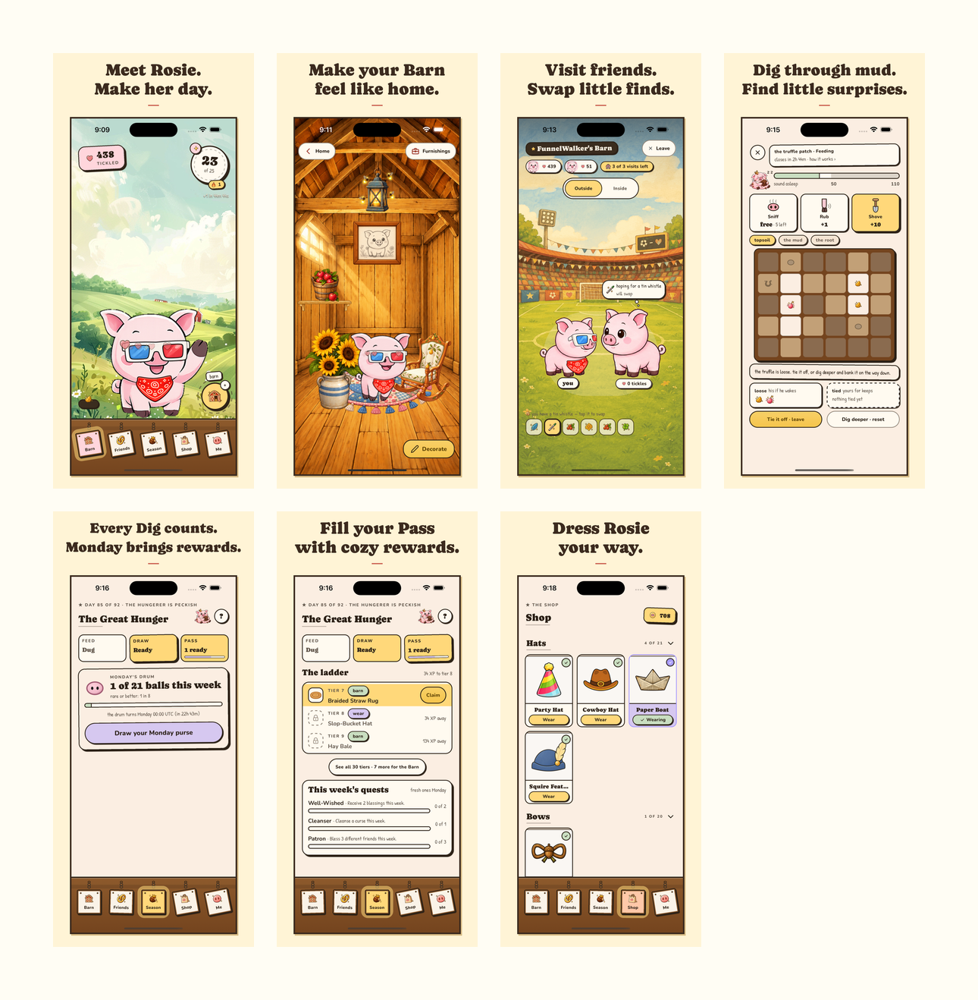

# App Store screenshots — v1.3, build 196

Status: **all seven screenshots uploaded and saved to the App Store Connect v1.3 draft on 2026-10-03**. The owner approved the set before upload. The saved order matches the numbered files below.

The numbered PNGs in this directory are the upload set, in order. Each is **1290 × 2796, RGB, opaque PNG**, accepted for the iPhone 6.9-inch slot. Build 196 is iPhone-only. English (U.S.) is the sole saved localization. Its 6.9-inch slot contains all seven images; the older custom 6.5-inch set was replaced with automatic inheritance. Media Manager confirmed **Using 6.9\" Display** and seven screenshots for 6.5, 6.3, 6.1, 5.5, 4.7, 4, and 3.5-inch displays. Returning to the version page confirmed the saved order and a disabled Save button. This completes screenshot preparation; app submission remains pending.

Upload evidence: [`app-store-connect-screenshots-uploaded.png`](../../../artifacts/release-1.3/app-store-connect-screenshots-uploaded.png). All six previous 6.5-inch original PNGs were downloaded at 1284 × 2778 before replacement and remain recoverable by reupload under `artifacts/release-1.3/screenshots/previous-app-store-6.5/`.

| Order | File | Caption |
|---|---|---|
| 1 | `01-rosie-home.png` | Meet Rosie. Make her day. |
| 2 | `02-cozy-barn.png` | Make your Barn feel like home. |
| 3 | `03-friend-visit.png` | Visit friends. Swap little finds. |
| 4 | `04-living-mud.png` | Dig through mud. Find little surprises. |
| 5 | `05-monday-drum.png` | Every Dig counts. Monday brings rewards. |
| 6 | `06-season-pass.png` | Fill your Pass with cozy rewards. |
| 7 | `07-closet.png` | Dress Rosie your way. |

## Capture evidence

- Frozen source: `ecda223413e5edc9f203731dda1597ccee68e168`, the documented build 196 candidate. No application source, game assets, or feature flags were edited for capture.
- Device: iPhone 16 Plus Simulator, iOS 18.6, on 2026-10-03. Captured with Simulator's native **Save Screen** control.
- A local **Release** simulator companion embedded the frozen source in production mode. This is screenshot staging, not the signed TestFlight binary, a distributable build, or new evidence of physical-device acceptance. Its native bundle version is 1; the store binary remains 1.3 (196).
- Production public configuration was used, with Sentry disabled locally and symbol auto-upload disabled for this capture companion. Expo Updates was disabled, so the embedded source remained the displayed UI. CocoaPods adjusted its lockfile and native dependency paths in the isolated worktree only.
- The simulator authentication verifier cannot parse a universal executable. It passed after extracting the unmodified arm64 slice with `lipo`; normal signing and the embedded Apple Sign In entitlement were retained.
- The populated review account provided real existing furnishings and cosmetics. Its Barn was arranged through the game's normal editor. The friend visit shows a wish and matching Satchel find; the live Dig shows partially cleared mud and recovered finds; the Drum shows one earned ball and printed odds; the Pass has a claimable Barn reward. The Closet screenshot uses the owned hat/bow grid, with Paper Boat selected.
- The compositions preserve each complete authentic screen. Captions, frame, and opaque background are added around it; no UI is invented, cropped away, or retouched. Lead review covered full-size and thumbnail readability, developer controls, prompts, private information, and retired/hidden features.

Per-file sizes and SHA-256 hashes, including raw capture hashes, are in [`manifest.json`](manifest.json). Original screenshots, the simulator build log, and the repeatable export script are retained under `artifacts/release-1.3/screenshots/`. The upload ZIP is `artifacts/release-1.3/screenshots/tickle-the-pig-1.3-screenshots.zip`; upload the seven numbered PNGs, not the contact sheet or manifest.

Apple's current [screenshot specifications](https://developer.apple.com/help/app-store-connect/reference/app-information/screenshot-specifications/) were checked on 2026-10-03.
